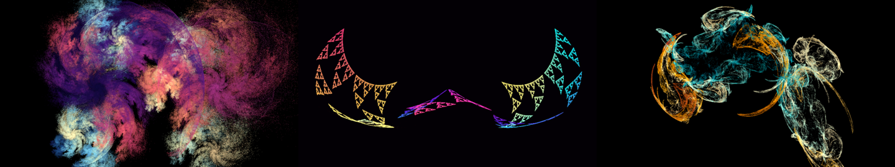

# flamebeat

Music-synced fractal flame visualizer.

- `analysis/`: Python (uv) offline analysis. It turns a song's full mix (no
  stem separation) into a JSON timeline of volume, energy, drum transients,
  beats, chroma, bass pitch and note events.
- `web/`: a static WebGPU fractal flame renderer (ES modules, no build step).
  It plays the track in an `<audio>` element and drives the flame from the
  timeline, sampled at `audio.currentTime`.

See `PLAN.md` for the plan, the timeline JSON schema and the progress log.



## Quickstart

You need [mise](https://mise.jdx.dev) tools `uv` and `just`, plus `node` for the
optional headless checks.

```sh
just fetch                                  # download the CC BY test track (Funkorama, Kevin MacLeod)
just analyze assets/audio/Funkorama.mp3     # -> web/timelines/Funkorama.json + analysis/out/Funkorama*.png
just serve                                  # http://localhost:8000/web/  (Ctrl-C to stop)
```

Open `http://localhost:8000/web/` in a WebGPU browser (recent Chrome/Edge;
Firefox/Safari with WebGPU enabled) and press **space** to play. The page has
to be served from `localhost` or https, because WebGPU needs a secure context.
Use `just serve` and not `python -m http.server`: the built-in server ignores
HTTP Range requests, and without them the browser can't seek in the audio.

### Controls

| key | action |
| --- | --- |
| space | play / pause |
| ← / → | seek −5 s / +5 s (shift: 30 s) |
| P | next preset |
| D | debug overlay (live signal bars, drum and beat flashes, chroma) |
| M | route editor (also the **routes** button): pick source → parameter, set amount |
| [ / ] | fewer / more iterations per frame |
| H | hide the bottom bar and HUD |

URL parameters: `track=<name>` (loads `../assets/audio/<name>.mp3` and
`timelines/<name>.json`), `audio=<url>`, `timeline=<url>`, `preset=0..3`,
`chains=65536`, `iters=178` (~700 M iter/s at 60 fps), `fade=0.15` (seconds), `decay=` (fixed per-frame, legacy), `res=1` (resolution scale),
`lookahead=0.03`, `t=<s>` (start position), `follow=1` (turn on camera follow).

### Adding a track

1. Put the audio file in `assets/audio/` (gitignored). Record its license in
   `assets/ATTRIBUTION.md`.
2. Run `just analyze assets/audio/<name>.mp3`. This writes `web/timelines/<name>.json`.
   For a meter other than 4/4 pass it as the second argument, e.g.
   `just analyze "assets/audio/<name>.mp3" 9/8` (`analyze.py --meter 9/8 --groups 2+2+2+3`
   to change the grouping; 6/8, 9/8 and 12/8 default to groups of 3). The meter is
   not detected: bars are counted in tracked beats (the meter's pulse).
   Check `analysis/out/<name>.png` (overview) and `<name>_zoom.png`. To zoom
   into another window, run `uv run python plot.py ... --start S --dur D` in `analysis/`.
3. Open `http://localhost:8000/web/?track=<name>`, or use the **open…** button
   to pick an audio file. The page loads `timelines/<stem>.json` automatically;
   you can also pick the audio file and its JSON together.

## How it works

### Analysis (`analysis/`, Python 3.10)

`analyze.py <audio> -o <timeline.json>` loads mono audio at 22050 Hz. Features
are computed with a 220-sample hop and resampled onto an exact 100 fps grid.

- **Volume**: momentary loudness (BS.1770 K-weighting from pyloudnorm, 400 ms
  window) mapped to 0..1, plus raw LUFS and 50 ms RMS dB.
- **Energy**: sub/bass/mid/high band energies (top 30 dB, per track),
  spectral flux, and `intensity`, a smoothed mix of flux, onset density and
  band energy.
- **Drums**: HPSS percussive part → per-band log-flux envelopes. Candidate
  onsets use an adaptive median+MAD threshold. Each candidate is classified:
  kick (30–120 Hz), snare (broadband: 1–4 kHz *and* 7–11 kHz), and hat
  (7–11 kHz, picked on its own envelope). Generic `onsets` come from librosa.
- **Beats**: librosa beat tracker. The grid is shifted by the median
  beat→onset offset. Downbeats are approximate: every 4th beat, with the phase
  taken from the kick energy.
- **Pitch**: CQT chroma on the harmonic part; bass f0 from pYIN (40–250 Hz,
  on a low-passed copy) with its voiced probability; note events from
  basic-pitch (tflite runtime).

`plot.py` draws every stream and event for checking by eye (example:
`docs/analysis-zoom-64s.png`). Tuning notes for
the test track are in the PLAN.md log.

### Renderer (`web/src/renderer/`)

- A compute pass runs 64k persistent chaos-game chains, each with a PCG RNG
  state, for N iterations per frame. Transforms are picked from a cumulative
  weight table. There are 10 variations (linear, sinusoidal, spherical, swirl,
  horseshoe, polar, heart, disc, spiral, julia) and an optional final transform.
- Hits go into a fixed-point `atomic<u32>` histogram (density + RGB). Each
  frame a decay pass scales it by `decay` instead of clearing it, which gives
  temporal smoothing and trails.
- A tone-map pass does flam3-style log density, gamma and vibrancy, drawn
  as a full-screen triangle.
- The camera auto-frames the attractor using a small CPU chaos game. With
  `?follow=1` it keeps re-framing as the mapping reshapes the flame. This is
  off by default because the random sampling makes the whole view drift a little.

### Mapping (`web/src/mapping.js`)

`MAPPINGS` is the default table of routes, `{ src, target, amount }`, where
`src` is a key of `SOURCES` and `target` a key of `TARGETS`. Each source brings
its own envelope (gain, curve, attack/release in media time, or an impulse
shape for events); each target has a neutral value and an output range. A
route adds `amount × (range value − neutral)` to its target, so routes to the
same target stack, 0 switches a route off and negative amounts invert it.

The **route editor** (M, or the *routes* button) edits this table live: a
source select, a target select and an amount slider (−2…2, double-click resets
to 1) per row, plus a live envelope meter, add/remove, and reset to defaults.
Edits are saved in `localStorage`. Sources: volume, intensity, flux, the four
band energies, kick/snare/hat/beat/onset/note hits, chroma and bass pitch.

Defaults:

| signal | → | parameter |
| --- | --- | --- |
| volume | → | brightness ×0.45…1.25 |
| intensity | → | spin speed of xform 0 (0.03…0.55 rad/s), iterations ×0.55…1 |
| kick | → | zoom pulse +9 %, xform-1 weight bump |
| snare | → | palette offset kick |
| hat | → | brief blend of the last xform toward julia |
| chroma (circular mean) | → | palette position |
| bass f0 (confidence-gated, held) | → | rotation of xform 1 |

Affines are clamped to a maximum singular value of 0.98 so the shape can't
blow up. Drum impulses are computed directly from the event list with a 30 ms
lookahead, so visuals can lead the audio slightly. Timeline queries are
stateless, and the envelopes reset when media time jumps, so pause, seek and
playback-rate changes all work.

## Testing / verification

```sh
just tools-install     # playwright-core (dev only)
just test              # node checks: interpolation, event windows, lookahead, seek/pause, contractivity
just serve &           # then:
just verify            # headless Chromium: snapshots at several timestamps + playback/pause/seek/rate + keys
```

What has been verified in this container (no GPU, no audio output):

- WebGPU runs in headless Chromium through the **SwiftShader** software adapter
  (`--enable-unsafe-webgpu --enable-features=Vulkan --use-angle=swiftshader
  --use-webgpu-adapter=swiftshader`). Plain page screenshots and
  `canvas.toDataURL()` come out blank there, so frames are read back through
  an offscreen texture (`window.__grab()`, used by `tools/grab.mjs` and
  `tools/verify.mjs`). See `docs/presets-headless.png` and
  `docs/timeline-snapshots-headless.png`.
- The mp3 loads and plays in headless Chromium. The render clock matches
  `audio.currentTime`. Pause freezes the visuals, seeking works, and 1.5×
  playback advances media time 1.5× faster. The keyboard controls and the
  debug overlay work.

## Known limits / unverified

- **Not verified on a real GPU.** Frame rate and appearance at 1080p on real
  hardware haven't been measured. SwiftShader gives about 12 fps at 960×540
  with 16k chains × 8 iterations, which says nothing about real-GPU speed.
- **Not verified with sound.** There is no audio output here. Whether the hits
  *feel* in sync, and whether the 30 ms lookahead suits real output latency,
  still needs a human with speakers.
- Drum classification was tuned by eye on one track (bar-position histograms
  look right: snares land on beats 2 and 4). It hasn't been checked against
  hand-labelled ground truth, and other genres will need different thresholds.
- Downbeats are a heuristic (4/4 assumed, no metre changes).
- The timeline JSON is about 3.8 MB for a 3:21 track (chroma is about 40 % of it).
- basic-pitch pins the analysis to Python 3.10, `numpy<2` and `setuptools<81`
  (see the PLAN.md log). `just analyze` doesn't skip notes, but
  `analyze.py --no-notes` does.

## Credits

Test track: "Funkorama" by Kevin MacLeod (incompetech.com), licensed under
Creative Commons: By Attribution 3.0 (https://creativecommons.org/licenses/by/3.0/).
Details are in `assets/ATTRIBUTION.md`.
